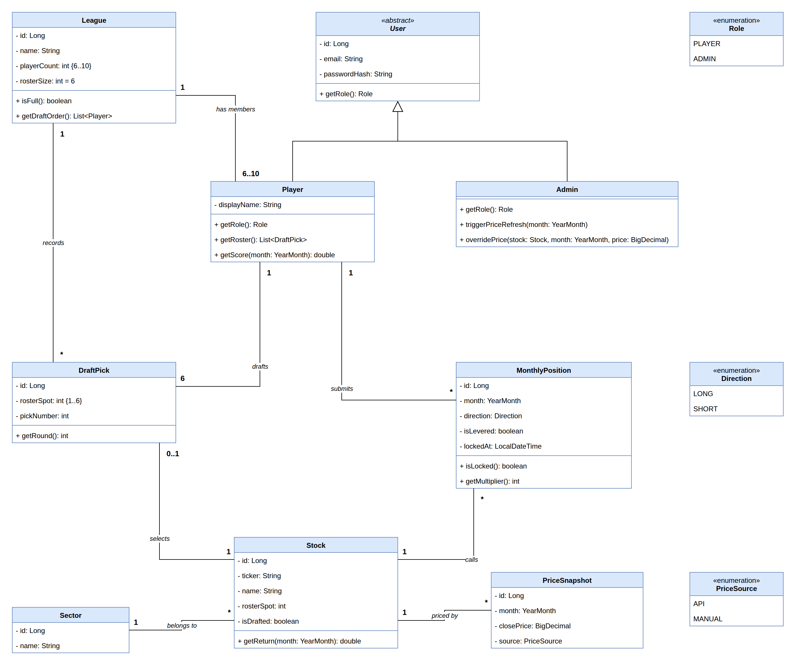

# Alpha Draft

A fantasy-sports-style platform for stock picking. Six to ten players draft a sector-balanced, duplicate-free roster of six stocks, then re-commit every month to a long or short call on each holding — plus one 2x-levered pick. Scores are computed from real closing prices, and a season-long leaderboard tracks who called it best.

Built as a Software Studio backend project — full CRUD, two-role authentication, and a real database. Price data comes from a market-data API, but only as a scheduled backend ingestion job: the live app never calls the API in real time, so nothing external is on the critical path during a demo.

## Why This Project

Everyone has opinions about which stocks are overvalued or undervalued, but there's no easy, low-stakes way to actually test those calls against friends. Alpha Draft turns that into a season-long competition with real structure: you can't just pick your six favorite tech names and coast, and you can't set a roster once and forget about it — every month forces a fresh long/short decision, plus a bet on which one call you believe in most.

## League Format

- **6–10 players per league**, configurable when the league is created.  
- **6-round snake draft** — draft order is randomized once at season start, then reverses each round.  
- **6 roster spots**, one filled per round:  
  1. **Technology** — its own dedicated spot, since it's the largest sector by market weight in the S\&P 500\.  
  2. **Financials / Real Estate**  
  3. **Healthcare / Consumer Staples**  
  4. **Energy / Materials**  
  5. **Industrials / Consumer Discretionary**  
  6. **Utilities / Communication Services**

Each round is restricted to that round's eligible sector(s), and a stock is removed from the pool league-wide the moment anyone drafts it — no duplicate tickers.

## How It Works

### 1\. The Draft

Players fill their six roster spots one round at a time, snake-style, choosing from that round's eligible sector pool. A completed roster satisfies all six spots with no duplicate tickers anywhere in the league.

### 2\. Monthly Long/Short Calls \+ Levered Pick

The roster is fixed for the season. Each month, every player:

- Chooses **long or short** for each of their six holdings.  
- Designates **exactly one** of the six as that month's **levered pick** — its return counts double (2x), win or lose.

Calls lock once the month begins.

### 3\. Pricing & Scoring

- A scheduled ingestion job pulls each stock's closing price from a market-data API (see [Pricing Source](#pricing-source) below) and stores it in the app's own `price_snapshots` table.  
- All scoring and leaderboard logic reads only from that stored data — never live from the API — so a network issue or rate limit never affects the running app or a live demo.  
- Monthly team score \= sum across all six spots of `(± return) × leverage`, where the sign flips for a short and the levered spot gets a 2x multiplier.

## Pricing Source

Price data comes from **Twelve Data** (`/quote`, free tier: 8 calls a minute, so a full refresh of the 503-stock S&P 500 pool takes about an hour). Set `TWELVE_DATA_API_KEY` in `skeleton/.env`.

- **Ingestion, not live lookup.** Admin (or a scheduled task) triggers the monthly refresh; results are cached in `price_snapshots` and reused for every score/leaderboard calculation.  
- **Admin override fallback.** If the API fails to return a price for a stock, or returns something clearly wrong, Admin can manually enter or correct that stock's closing price. Manual entries are flagged as `source: manual` versus `source: api` so the team can always see where a price came from.  
- **Adjusted close.** The ingestion job should request split/dividend-adjusted closing prices where the API supports it, so a stock split mid-month doesn't read as a huge (and fake) price move.  
- **API key handling.** Store the key in a `.env` file, gitignored — never commit it to the shared repo.

## Roles & Permissions

| Role | Can do |
| :---- | :---- |
| **Admin** | Manage the stock pool and sector assignments, trigger the monthly price refresh job, manually override/backfill a price when the API fails, manage league/season settings |
| **Player** | Draft stocks (within league rules), submit monthly long/short calls and levered-pick selection (until locked), view leaderboard and own roster history |

The two-role split is a real authentication requirement, not just a feature: Admin's job didn't disappear when pricing became API-driven — it shifted from manual data entry to managing the pool, triggering ingestion, and handling exceptions.

## Running Locally

**Backend** (Spring Boot + JPA on Supabase PostgreSQL):

1. `cd skeleton`, copy `.env.example` to `.env`, and fill in the Supabase **Session pooler** connection (Supabase → Connect), a `JWT_SECRET`, and an `ADMIN_EMAIL` / `ADMIN_PASSWORD`.
2. `./mvnw spring-boot:run` (Windows PowerShell: `.\mvnw.cmd spring-boot:run`). The app reads `.env` itself, creates or updates the `users`, `stocks` and `stock_audit_log` tables, seeds every S&P 500 stock (from `skeleton/src/main/resources/starter-stocks.txt`) into an empty table, and creates the admin account. It runs on http://localhost:8080.

**Frontend:** `cd frontend`, then `npm install` and `npm run dev`, and open http://localhost:5173.

**What's implemented now:**

| Concern | Where |
| :---- | :---- |
| Supabase connection and JPA settings | `skeleton/src/main/resources/application.properties` |
| Entities and relationship | `model/User.java`, `model/Stock.java` (`@ManyToOne` `draftedBy` → `User`), `repository/StockAuditEntry.java` |
| Repositories | `repository/UserRepository.java`, `StockJpaRepository.java`, `StockAuditJpaRepository.java` |
| Sign-up and sign-in (backend only, BCrypt, JWT) | `auth/AuthController.java`, `AuthService.java`, `TokenService.java` |
| Backend role enforcement | `config/SecurityConfig.java`, `auth/JwtAuthenticationFilter.java` |
| Admin account | `config/AdminAccountSeeder.java` (from `ADMIN_EMAIL` / `ADMIN_PASSWORD`) |
| Frontend role enforcement | `frontend/src/pages/StocksPage.jsx` (admin-only controls), `auth/AuthContext.jsx` |

Anyone who signs up is a **PLAYER**, who can view the stock pool. Only the **ADMIN** can add, edit or delete stocks. Those requests return 403 for a player and 401 when signed out.

## Data Model (proposed)

| Table | Purpose | Key fields |
| :---- | :---- | :---- |
| `sectors` | Sector reference list | `id`, `name` |
| `stocks` | Draftable ticker pool, tagged to a roster spot | `id`, `ticker`, `name`, `sector_id`, `roster_spot`, `is_drafted` |
| `users` | Accounts | `id`, `email`, `password_hash`, `role` (admin/player) |
| `leagues` | A season/league instance | `id`, `name`, `player_count` (6–10), `roster_size` (6) |
| `draft_picks` | Who drafted what, and in which round/spot | `id`, `league_id`, `user_id`, `stock_id` (unique), `roster_spot`, `pick_number` |
| `monthly_positions` | Each player's call per stock per month | `id`, `user_id`, `stock_id`, `month`, `direction` (long/short), `is_levered`, `locked_at` |
| `price_snapshots` | Closing prices, API-sourced or admin-overridden | `id`, `stock_id`, `month`, `close_price`, `source` (api/manual) |
| `monthly_scores` | Cached computed scores (optional but recommended) | `id`, `user_id`, `month`, `score` |

Full CRUD lives most clearly on `monthly_positions` (create/read/update/delete a call before lock) and on Admin's management of `stocks` and `price_snapshots`.

## Class Diagram

The domain model above is exported from [`docs/class-diagram.drawio`]
(docs/class-diagram.drawio). Open that file with the Draw.io Integration
extension in VS Code to edit it, then re-export `docs/class-diagram.png`
(File → Export as → PNG) and commit both files.

## Design Pattern Register

Design patterns we've applied to real problems in this codebase, with where to find them.

| Pattern | Where | Problem it solves | Ticket |
| :---- | :---- | :---- | :---- |
| **Strategy** | `skeleton/src/main/java/com/alphadraft/skeleton/validation/` (`StockValidationRule` plus `RequiredFieldsRule`, `AllowedSectorRule`, `UniqueTickerRule`), used by `StockService.createStock` / `updateStock` | A stock must pass several checks before it is saved: every field is filled in, the sector is one of the 11 GICS sectors, and no other stock already uses the ticker. Without a pattern these checks become one long if/else block inside `StockService` that grows with every new rule. Each check is now its own class with the same `validate(stock, idBeingUpdated)` method. Spring injects every rule into `StockService`, which runs them all and returns a 400 with `{ "errors": { field: message } }` if any fail. Adding a rule means adding one class; `StockService` doesn't change. Each rule has its own unit tests in `skeleton/src/test/.../validation/`. | SCRUM-23 |
| **Strategy** | `frontend/src/strategies/stockListStrategies.js`, used by `frontend/src/components/StockList.jsx` | Users need to sort the stock pool several ways (date added, ticker A–Z / Z–A, company name, sector) and filter it by sector. Without a pattern this becomes a growing if/else chain inside `StockList`. Each sort is now an interchangeable object with the same `{ label, compare }` shape, and each filter has the same `{ label, matches }` shape, so `StockList` just applies whichever one the user picks. This keeps `StockList` open for extension but closed for modification (Open/Closed Principle): adding a new sort or filter means adding one entry to the strategies file; `StockList` doesn't change. Tested in `stockListStrategies.test.js`. | SCRUM-26 |
| **Decorator** | `skeleton/src/main/java/com/alphadraft/skeleton/repository/AuditingStockRepository.java`, wired in `config/RepositoryConfig.java` | Admins add, edit and delete stocks in the shared pool, and nothing recorded what changed or when. Logging inside every `StockService` method would give the service a second job and is easy to forget in new methods. `AuditingStockRepository` implements `StockRepository` and wraps another one: each `save` / `deleteById` goes to the real repository unchanged, then a `StockAuditEntry` (CREATE, UPDATE or DELETE, stock id, ticker, time) is added to the audit log. `RepositoryConfig` does the wrapping in one line, `new AuditingStockRepository(new InMemoryStockRepository())`, so `StockService` and the storage don't change. Tests are in `skeleton/src/test/.../repository/AuditingStockRepositoryTest.java`. | Stock pool audit |

## Suggested Tech Stack

- **Backend:** Flask \+ SQLAlchemy (ORM makes the sector/spot validation and scoring logic much cleaner than raw SQL)  
- **Database:** SQLite for local dev, Postgres if deploying somewhere persistent  
- **Auth:** Flask-Login or Flask-JWT-Extended for the two-role system  
- **Price ingestion:** A Python script/module using `requests` against the chosen API, triggered by an Admin-facing endpoint (simplest) or a scheduled job (APScheduler or a cron-triggered script, if the team wants full automation)  
- **Frontend:** Jinja templates for a fast MVP, or a lightweight React frontend if the team wants a more modern client  
- **Dev environment:** VS Code, with a shared `.vscode/` config (recommended extensions, launch config) so everyone's debugging setup matches  
- **Version control:** GitHub, trunk-based with short-lived feature branches per Jira ticket; `.env` (API keys) gitignored

## Suggested Task Breakdown

**Auth & Roles**

- Set up user model with Admin/Player roles  
- Registration/login flow  
- Route-level permission checks (Admin-only endpoints)

**League & Draft Engine**

- League/season creation (Admin), configurable 6–10 player capacity  
- Stock pool \+ sector/roster-spot setup (Admin)  
- 6-round snake draft pick flow, one round per roster spot  
- No-duplicate validation across the league  
- Draft completion check (all 6 spots filled)

**Monthly Positions**

- Submit long/short call per stock  
- Select one levered (2x) pick per month  
- Lock mechanism (no edits after month start)  
- View own roster \+ position history

**Pricing & Ingestion**

- Integrate chosen market-data API client  
- Monthly price refresh job → `price_snapshots`  
- Flag stocks missing a price after refresh  
- Admin manual override/backfill flow

**Scoring & Leaderboard**

- Scoring calculation (per-stock return, long/short sign flip, leverage multiplier)  
- Season leaderboard view/API  
- Historical monthly breakdown per player

**Frontend / UX**

- Draft board UI (round-by-round, spot-restricted)  
- Monthly call \+ levered-pick submission UI  
- Leaderboard \+ roster views  
- Admin console (stock pool, price refresh/override)

**QA & Deployment**

- Unit tests on scoring \+ validation logic, especially the leverage multiplier and short sign flip (highest priority — this is what a grader will poke at)  
- Seed data / pre-loaded demo season so the leaderboard looks real on demo day  
- Deployment (or a reliable local demo setup)

## Open Decisions To Finalize

A few rules the team should settle explicitly before they come up mid-sprint:

- **Tie-breaker** for identical leaderboard scores.  
- **Corporate actions** — what happens if a held stock is acquired or delisted mid-season.  
- **Price-entry immutability** — should a finalized month's prices be locked/audit-logged rather than freely editable.

## Running the league

Backend (`skeleton/`): `.\mvnw.cmd spring-boot:run` (reads `skeleton/.env`). Frontend (`frontend/`): `npm install` then `npm run dev` (http://localhost:5173).

1. **Players** create an account, then ask to join with a team name.
2. **Admin** (Admin tab) accepts each request. The league size (6–10) decides how many bot teams fill the rest.
3. **Admin** sets the draft day and time, or starts the draft by hand. The draft also starts on its own at the set time. Bots pick on their turns; players pick in the Draft room.
4. **Admin** sets the season's first month (for example `2026-12`) and starts the season. The season is a full quarter: three months.
5. Each month, players set long or short on every roster stock and one 2x pick, then submit. Calls lock when the month starts; a player who does not submit carries over last month's calls. Bots submit random calls.
6. **Admin** refreshes closing prices and finalizes each month once every drafted stock has a price. A price can be corrected by hand; corrections are recorded in the audit log.

Points per month = sum over the roster of (±return % × 2 for the 2x pick), with a short call flipping the sign. The season total is the sum of finished months.

## Database and authentication (for review)

**JPA and Supabase**
- Connection and schema settings: `skeleton/src/main/resources/application.properties` (`SUPABASE_DB_*` variables, `ddl-auto=update`).
- Repository wiring: `skeleton/src/main/java/com/alphadraft/skeleton/config/RepositoryConfig.java`.

**Data model (JPA entities and relationships)**
- Stocks: `model/Stock.java`. Each stock may belong to a player (`@ManyToOne User draftedBy`).
- Users: `model/User.java`.
- Daily closing prices: `model/DailyPrice.java`. `@ManyToOne Stock` (read-only association over the stored `stock_id`).
- League: `league/League.java`, `league/Team.java`, `league/DraftPick.java`, `league/CallSheet.java`, `league/CallPick.java`, `league/PriceSnapshot.java`, `league/LeagueAudit.java`. Draft picks and call rows reach their team with `@ManyToOne Team`; price snapshots reach their stock with `@ManyToOne Stock`.
- Relationship test: `skeleton/src/test/java/com/alphadraft/skeleton/league/LeagueRelationshipsTest.java`.

**Sign-up and sign-in (through the backend only)**
- Backend: `auth/AuthController.java`, `auth/AuthService.java`, `auth/TokenService.java`, `auth/JwtAuthenticationFilter.java`.
- Frontend: `frontend/src/services/stockService.js` and `frontend/src/auth/AuthContext.jsx`. React calls only the backend; it never calls Supabase.

**Two roles, enforced on both ends**
- Backend: `config/SecurityConfig.java` (`/admin/**` and admin-only stock actions need `ROLE_ADMIN`; the league's player actions need a signed-in user).
- Frontend: `components/NavTabs.jsx` and `App.jsx` show admin screens only to admins.

**Restart persistence**
- `skeleton/src/test/java/com/alphadraft/skeleton/RestartPersistenceTest.java` starts the app twice against the same database and checks the data survives.
