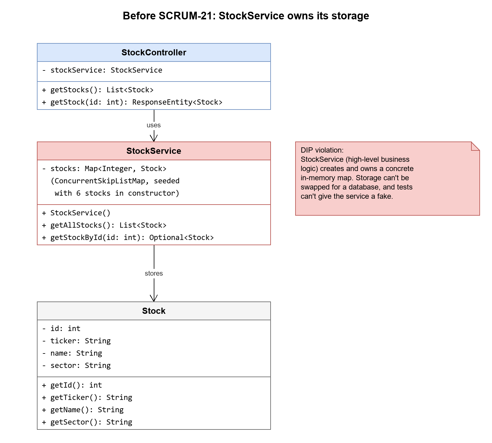
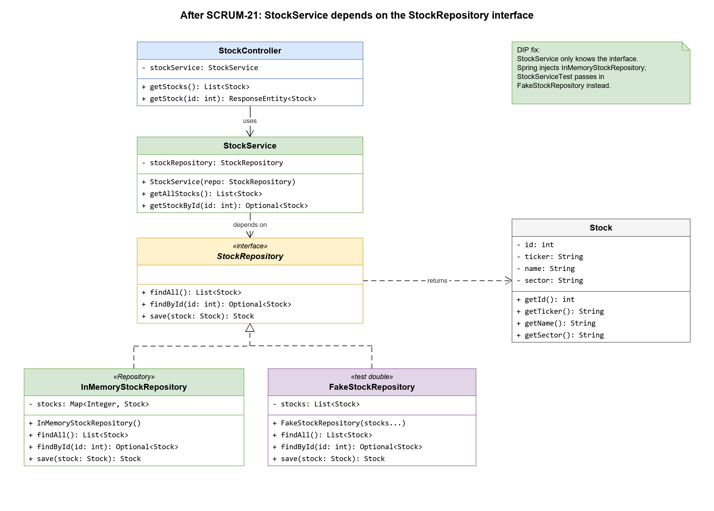

# SOLID Fix: Dependency Inversion in StockService (SCRUM-21)

**Principle:** Dependency Inversion Principle (DIP)

**Violation:** `StockService` (high-level business logic) created and owned its own
storage, a `ConcurrentSkipListMap` seeded with stocks in its constructor. The service
depended on a low-level detail, so storage could not be swapped (for example, for a
database), and the service could not be unit tested with fake data.

**Fix:** Added a `StockRepository` interface (`findAll`, `findById`, `save`) and an
`InMemoryStockRepository` implementation that holds the map and the seed data.
`StockService` now receives a `StockRepository` through its constructor and only
depends on the interface. Spring injects `InMemoryStockRepository` at runtime.
Behavior of `GET /stocks` and `GET /stocks/{id}` is unchanged.

## Tests

- `InMemoryStockRepositoryTest`: tests the real repository (seed order, find by id, unknown id, save new, save replaces, `findAll` returns a copy).
- `StockServiceTest`: tests the service with a hand-written `FakeStockRepository`, with no Spring and no real storage.
- `SkeletonApplicationTests`: checks that Spring wires `InMemoryStockRepository` into `StockService`.

Run with `./mvnw test` from `skeleton/`. All backend and frontend tests pass.

## Diagrams

Editable sources: [`solid-dip-before.drawio`](solid-dip-before.drawio) and [`solid-dip-after.drawio`](solid-dip-after.drawio).

### Before

### After

