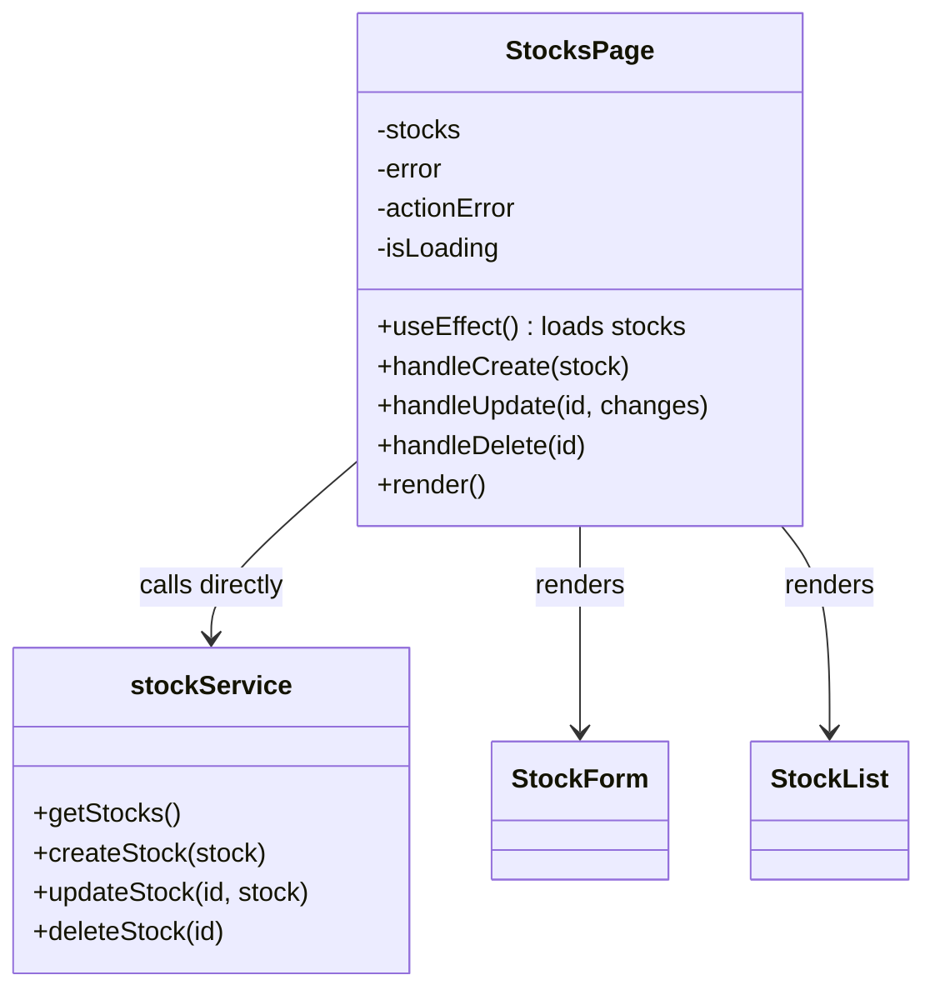
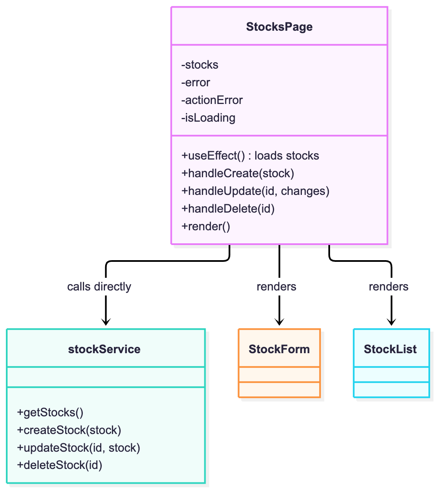
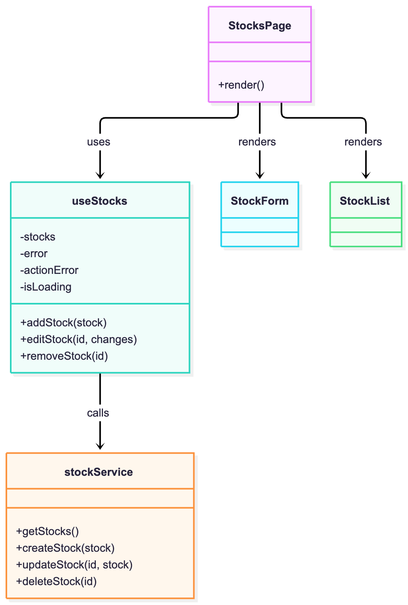

# SOLID Fix: Single Responsibility in StocksPage (SCRUM-25)

**Principle:** Single Responsibility Principle (SRP)

**Violation:** `StocksPage` had two reasons to change. It owned the page layout *and*
all stock data logic: loading state, error state, and the create/update/delete calls
to `stockService`. Any change to how data is fetched or saved meant editing the page
component.

**Fix:** Extracted the data logic into a custom hook, `useStocks`. `StocksPage` now
only renders layout and passes the hook's functions down to its children. Behavior
is unchanged, and all 14 existing frontend tests still pass.

## Before



## After

```mermaid
classDiagram
    class StocksPage {
        +render()
    }
    class useStocks {
        -stocks
        -error
        -actionError
        -isLoading
        +addStock(stock)
        +editStock(id, changes)
        +removeStock(id)
    }
    class stockService {
        +getStocks()
        +createStock(stock)
        +updateStock(id, stock)
        +deleteStock(id)
    }
    class StockForm
    class StockList
    StocksPage --> useStocks : uses
    useStocks --> stockService : calls
    StocksPage --> StockForm : renders
    StocksPage --> StockList : renders

## Diagram images



```